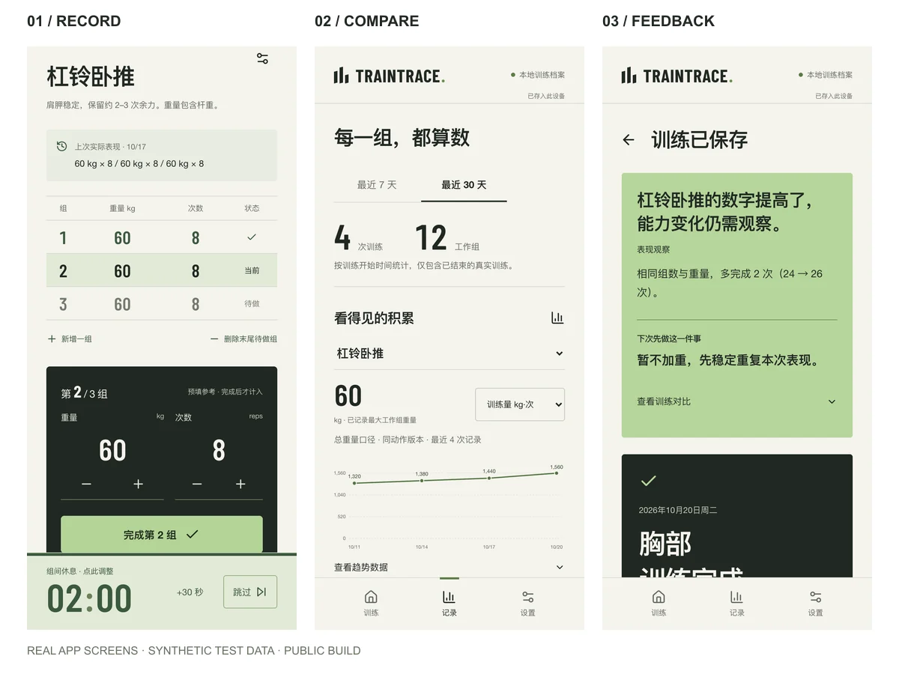
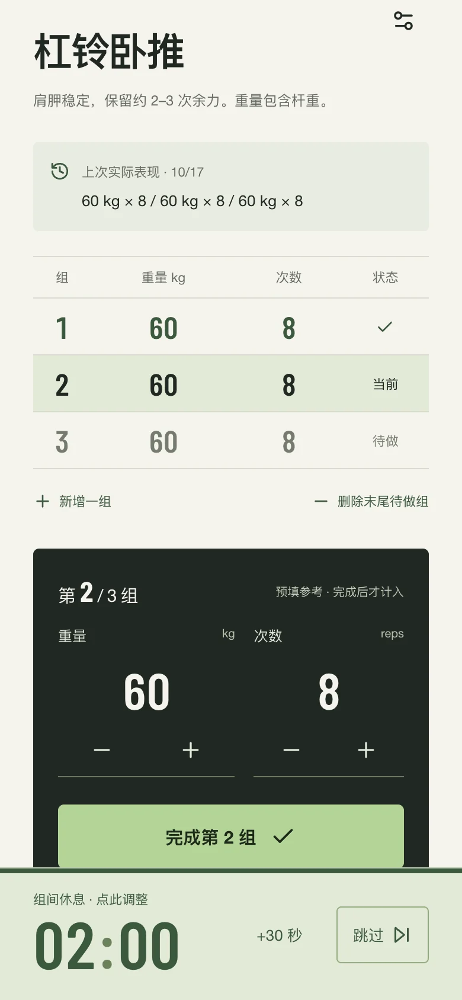
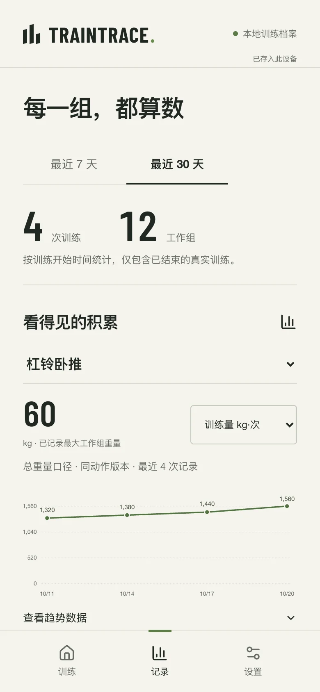
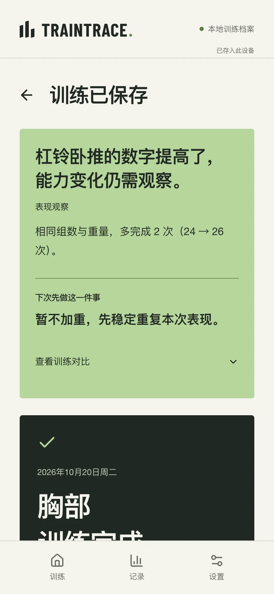

# TrainTrace

### 记录每一组，让下一次训练有所依据。

*Make Every Rep Count.*

一款面向日常力量训练的**智能训练记录工具**。连接训练记录、历史对比和专业反馈，让你知道今天练了什么，也知道下一次可以如何调整。

**[在线体验 →](https://cocobolo111-png.github.io/TrainTrace-Coach/)** · 无需注册 · 本地保存 · 支持离线记录



当前分支：**1.4.0-beta.1 · 人工验收候选版**，未覆盖线上 V1.3，未创建稳定标签。上方体验链接仍指向已发布版本。V1.4 新增审核动作指导、设置后直接进入候选计划，以及可选个人 DeepSeek 接入。

## Why TrainTrace · 记录之后，还差一步

记下「60 kg × 8 次」并不难。难的是训练结束后，仍要自己翻记录、对齐条件，再回答三个问题：

- 今天比上次进步了吗？
- 是重量、次数变了，还是训练条件不同？
- 下一次应该加重、保持，还是先调整？

TrainTrace 希望缩短从**记录训练到理解训练**之间的距离：训练时少操作，结束后先看变化和下一步，再按需展开数据依据。

它的核心是智能训练记录与专业反馈。已有的精简候选计划帮助开始一节训练；它不承担完整 AI 私教、医疗判断或长期训练周期规划。

## Core Experience · 从这一组，到下一次

以下均为公开静态构建的真实界面，使用隔离浏览器中的**合成测试数据**，不代表真实用户记录、使用成绩或 AI 生成结果。新用户打开产品时没有预置训练历史。

### 01 — 快速记录

训练中，确认重量和次数，点击完成本组，记录随即保存。上次表现就在手边，不必来回翻找；组数可现场调整，完成后自动开始组间休息计时，感受与 RPE 可选填。



### 02 — 历史对比

按动作查看重量或训练量趋势，回看每次实际完成的记录。系统区分动作版本与重量口径，避免把不同器械、不同变式的数字直接混在一起比较。



### 03 — 专业反馈

结束后，先看到结论、依据和一条可执行建议。示例中，相同重量与组数下，总次数从 24 增至 26；系统描述数字变化，同时保留对能力变化的判断，建议先稳定重复表现。反馈由本地规则生成，无需等待模型。



## Behind the Product · 三个设计取舍

### 先记得下来，再补充感受

重量、次数与完成状态构成记录主线。训练感受、准确 RPE 和动作质量是可选补充，不把每一组变成问卷。对应的代价也必须诚实：缺少强度或动作质量证据时，反馈只描述可确认的变化，不替用户补全事实。

### 先回答「练得怎样」，再展开数字

训练总结将反馈放在原始记录之前，并把「下次先做这一件事」单独突出。详细对比与实际组次仍可查看，让用户先获得行动参考，再追溯依据。

### 基础反馈可靠可用，AI 按需解释

统计、可比性判断和下一步建议由规则承担，不依赖外部模型。本地 AI 在用户主动点击后解释必要记录与服务端重算的规则结果，并按证据附加少量解释素材；失败时保留规则反馈和训练记录。AI 的作用是帮助理解，不替代事实与规则判断。

## How It Works · 建议从哪里来

**记录实际完成 → 对齐可比历史 → 生成规则反馈 → 作为下一次训练参考**

只有已完成的正式组计入训练量与反馈。系统核对动作、器械、变式和重量口径，结合近期可比记录判断变化；未完成的计划组不算成果，单次下降不直接判为平台期，缺失信息保持未知。

这条路径在浏览器内完成。可选的本地 DeepSeek 分析是后续解释层：用户主动请求 → 本机服务校验并重算 → 调用 DeepSeek 官方 API → 缓存解释。公开 GitHub Pages 不包含 AI 入口，也不提供公共 DeepSeek API 服务。

## Try It Yourself · 开始一节训练

**[打开 TrainTrace](https://cocobolo111-png.github.io/TrainTrace-Coach/)**

无需注册，完成首次引导和训练偏好设置，即可选择、调整候选计划并开始记录。结束后查看反馈，在「记录」中回看历史，在「设置 → 数据管理」导出备份。

- **手机**：直接在浏览器使用。iPhone / iPad 可用 Safari「分享 → 添加到主屏幕」；Android 可在 Chrome 菜单中安装或添加到主屏幕。
- **桌面**：浏览器标签页即可使用；支持时可通过 Chrome / Edge 菜单安装为应用或创建快捷方式。
- **离线**：首次需联网打开并等待资源加载，之后可离线记录。新版本就绪会提示刷新，训练中不主动刷新。

安装菜单随系统与浏览器变化。旧版若仍被缓存，结束训练后关闭本站全部标签页或应用窗口再重新打开，**无需清理浏览器数据**。参见 [Apple 主屏幕使用说明](https://support.apple.com/guide/iphone/iphea86e5236/ios) 与 [Chrome 网页应用说明](https://support.google.com/chrome/answer/9658361)。

**数据留在当前浏览器和站点，不会自动跨设备同步。** 清理站点数据、卸载浏览器、更换设备或存储被回收，都可能丢失记录。请定期导出完整 JSON 备份，并保存到浏览器之外；换设备后手动导入。分享网址不会分享训练数据。

公开版没有账号、云端训练数据库或公共模型额度。它提供的是训练参考，建议不替代医疗诊断或治疗。

## For Developers · 开发与开源说明

### 技术栈与代码入口

React 19、TypeScript、Vite；PWA / Service Worker 支持离线资源，IndexedDB 保存结构化训练事实，Zod 校验数据。可选分析使用本机 Node 服务连接 DeepSeek。

| 入口 | 职责 |
| --- | --- |
| [`src/model.ts`](src/model.ts)、[`src/storage.ts`](src/storage.ts) | 训练数据模型、完成统计、本地持久化与备份合并 |
| [`src/feedback.ts`](src/feedback.ts) | 可比历史、规则反馈与下一步建议 |
| [`src/FeedbackCard.tsx`](src/FeedbackCard.tsx) | 反馈优先的总结展示与按需 AI 入口 |
| [`server/analysis.ts`](server/analysis.ts)、[`server/explainer.ts`](server/explainer.ts) | 服务端校验、规则重算与有证据约束的模型解释 |

仓库保留可独立使用的 [`traintrace-coach/`](traintrace-coach/) Skill，用户档案模板为空；网页应用不依赖它读取私人训练文件。

### 本地安装与运行

需要 Node.js **22.12+** 与 pnpm **10.17.1**。

```sh
git clone https://github.com/Cocobolo111-png/TrainTrace-Coach.git
cd TrainTrace-Coach
corepack enable
corepack prepare pnpm@10.17.1 --activate
pnpm install --frozen-lockfile
pnpm dev
```

打开终端显示的本机地址。首次运行为空白状态，不扫描电脑中的训练文件，也不自动导入开发者数据。开发模式保留 AI 入口；未配置或启动代理时，规则反馈与训练记录仍可使用。

```sh
# 与 GitHub Pages 相同的公开静态模式：无 AI 入口，不请求模型
pnpm build
pnpm preview
```

### 可选：本地 DeepSeek 分析

GitHub Pages 仅托管静态 App：**不运行模型代理、不请求 localhost、不提供公共额度或公共 AI 接口**。详细 AI 分析只在开发模式或显式本地构建中启用。

```sh
cp .env.example .env.local
# 用编辑器在 .env.local 中填写自己的 DEEPSEEK_API_KEY
pnpm build:local
pnpm build:server
pnpm start
```

默认打开 `http://127.0.0.1:8787/`。服务默认只绑定本机；不要将它作为公共代理部署。`pnpm dev` 的同源分析请求也会转发到此代理。

密钥只由 Node 服务读取，**不得放入 `VITE_` 变量、前端代码、备份或 Git**。`.env.local` 已忽略；可用 `DEEPSEEK_MODEL` 指定官方模型，默认 `deepseek-flash`。

首次主动点击详细分析，才会将必要的本次及相关训练记录、训练偏好发送至 DeepSeek 官方 API，可能产生费用。失败后不自动重试，用户可手动重试。服务端重算统计与规则，按证据附加 0–2 条相关解释素材；证据不足时保留原反馈。

成功解释写入本地派生缓存，不修改训练事实，也不进入训练备份。公开构建输出到 `dist/`，本地 AI 构建输出到 `dist-local/`。切换站点来源（含主机名、端口）、浏览器或设备时，数据彼此独立，需自行通过备份迁移。

### V1.4 Beta：可选个人 AI

动作指导来自实际审核的 30 张 Action 卡元数据，已摘编 9 张：9 个目录动作默认可匹配，另有坐姿划船的明确绳索变式可匹配。未匹配动作仍正常记录；指导默认收起。首次设置后直接进入可调整候选计划，原有渐显引导保留。

完整 BYOK 版使用 **浏览器 → HTTPS 同源 Node → DeepSeek 官方 API**，支持 `deepseek-flash`、`deepseek-v4-pro`，均已用合成训练场景实测。OpenAI 本轮未接入。进入设置展开「连接你自己的 AI」，填入个人 Key、选择模型并验证。默认分析进步与下次行动，可选训练量；仅主动点击才调用一次模型。连接测试不发送训练记录，也不保证余额。

```sh
pnpm build:byok
pnpm build:server
PUBLIC_ORIGIN=https://train.byheyang.cn pnpm start:byok
```

以上命令启动回环服务，需复用现有 Caddy 提供同源 HTTPS；域名尚未启用，不代表运行命令后已部署。见 [部署方案与人工关口](deploy/README.md)。GitHub Pages 静态版不支持 BYOK，不做浏览器直连绕过。

Key 会经过本站服务器，但只保留在当前页面内存，刷新、断开即清除；不写入本地存储、备份或服务端日志。公共模式不读取私人环境 Key 兜底。缓存按事实、规则/解释版本、服务商、请求/实际模型与维度校验，缓存升级不改变训练 State。已有 `.env.local` 私人模式继续使用 `pnpm start`，只在本机运行。

### 数据存储与隐私

训练事实和偏好保存在当前浏览器、当前站点的 **IndexedDB**；提醒开关等展示设置使用本地 localStorage。备份合并遇到同 ID 不同内容会阻止合并，避免静默覆盖。

支持完整 JSON 导出、合并导入，以及明确格式的 Markdown 历史预览导入。Markdown 迁移不把计划、模板、待确认或模糊记录猜成实际完成数据。

公开仓库与网页产物不包含开发者私人训练日志、个人偏好、备份、密钥或真实 AI 分析。README 图片来自隔离浏览器的合成测试记录；测试夹具同样明确标注。应用离线缓存包含构建资源，不预置私人训练数据库。

### 测试、构建与发布

```sh
pnpm test
pnpm build
pnpm build:local
pnpm build:server
pnpm exec playwright install chromium
pnpm test:e2e
```

浏览器测试分别覆盖公开静态版与本地版，使用隔离浏览器和合成夹具，不读取私人日志。需要验证真实 API 时，可显式运行：

```sh
pnpm verify:deepseek /私有路径/训练备份.json --explainer
```

此命令需要自己的密钥和数据，不在 CI 执行。不要将私人备份放进仓库。

[GitHub Actions](.github/workflows/web.yml) 使用冻结锁文件安装，运行测试和两种前端 / 服务端构建，**仅发布 `dist/` 到 Pages**，不部署 `dist-local/`、`dist-server/` 或本地环境文件。当前版本仍为发布候选版；实体手机安装、系统后台、提示音与震动需按实际设备验收，浏览器模拟不等于真机确认。

### 开源许可

代码采用 [MIT License](LICENSE)。训练解释素材中的讲师表述保留来源标注，不代表官方授权、代言或效果保证；AI 整理与原创类比有独立标记。
